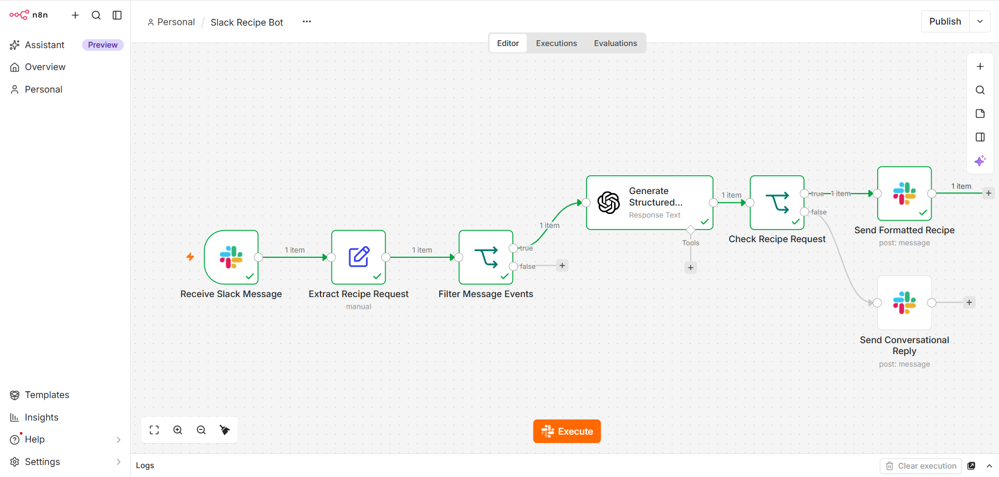
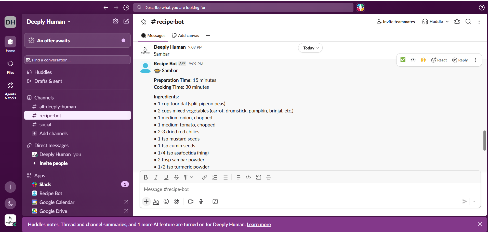
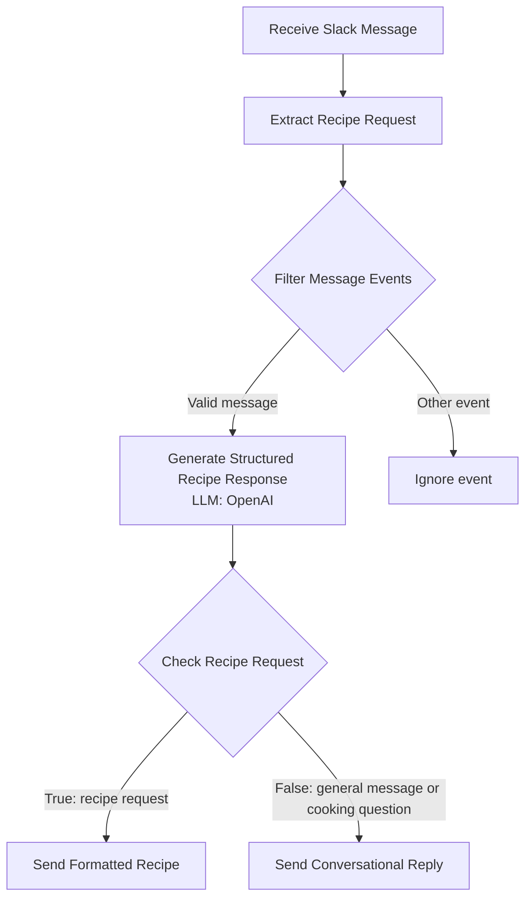

# Slack Recipe Bot: AI-Powered Cooking Assistant with n8n

An AI-powered Slack bot that generates structured recipes and answers general cooking questions. Built with n8n, Slack, and OpenAI, the workflow routes recipe requests and conversational questions to the appropriate response format.

## Demo

[Watch the demo video](https://github.com/user-attachments/assets/ddf60cf8-806f-4c63-9a02-390feead24d1)

## Screenshots

<table>
  <tr>
    <td width="50%">
      
      
n8n Workflow

    </td>
    <td width="50%">
      
      
Slack Bot Output

    </td>
  </tr>
</table>

## Workflow

## Features

- **Slack integration:** Receives messages from a designated Slack channel.
- **Structured AI output:** Uses an OpenAI model with JSON Schema output to return predictable recipe fields.
- **Recipe generation:** Provides dish name, preparation time, cooking time, ingredients, step-by-step instructions, and cooking tips.
- **Conversational responses:** Handles greetings and cooking-related questions without displaying empty recipe sections.
- **Event filtering:** Filters message events so deletion events are not treated as new requests.
- **Slack formatting:** Uses readable headings, ingredient bullets, and numbered instructions.

## How It Works

1. **Receive Slack Message** captures an event from Slack.
2. **Extract Recipe Request** maps the incoming message text into the `recipe` field.
3. **Filter Message Events** allows normal message events to continue and filters out events such as message deletions.
4. **Generate Structured Recipe Response (LLM)** sends the request to OpenAI and expects structured JSON with these fields:
   - `is_dish`
   - `dish_name`
   - `preparation_time`
   - `cooking_time`
   - `ingredients`
   - `instructions`
   - `cooking_tips`
   - `message`
5. **Check Recipe Request** checks `is_dish` to choose the response path.
6. **Send Formatted Recipe** formats and posts recipe details to Slack.
7. **Send Conversational Reply** posts the AI's conversational response for non-recipe requests.

## Example Requests

Send these messages in the configured Slack channel:

- `Paneer Butter Masala` — returns a formatted recipe.
- `Hello, how are you?` — returns a conversational reply.
- `What is the difference between baking and frying?` — returns a cooking-related explanation.

## Prerequisites

- An n8n instance (cloud or self-hosted).
- A Slack workspace and permission to create/configure a Slack app.
- An OpenAI API account and API credentials.
- Access to a Slack channel where the bot is invited.

## Setup

### 1. Import the workflow

1. Open n8n.
2. Import `Slack Recipe Bot.json`.
3. Open each Slack node and select your Slack credential.
4. Open the OpenAI node and select your OpenAI credential.
5. Review the channel selection in both Slack message nodes and choose your target channel.

### 2. Configure the Slack trigger

1. Configure the Slack Trigger to listen for new messages in the chosen channel.
2. Configure the Slack app's event subscription and required permissions according to your Slack setup.
3. Invite the bot to the channel.
4. Confirm that the trigger receives new messages.

### 3. Configure the AI response

1. In **Generate Structured Recipe Response (LLM)**, select your OpenAI model and credential.
2. Configure **Output Format** as **JSON Schema**.
3. Use the schema fields listed above and ensure the prompt handles both recipe requests and non-recipe messages.
4. Verify that empty or missing input does not result in an invented recipe.

### 4. Activate and test

Save the workflow and activate it. Send a new message in the configured Slack channel to test it. Avoid using stale manual-execution data when validating live Slack events.

## Test Cases

| Input | Expected behavior |
|---|---|
| `Paneer Butter Masala` | Sends a formatted recipe with timings, ingredients, instructions, and tips. |
| `Hello, how are you?` | Sends a conversational reply without empty recipe headings. |
| `What is the difference between baking and frying?` | Sends a relevant cooking explanation. |
| Delete a previously sent message | The deletion event is filtered and does not trigger a recipe response. |

## Repository Contents

- `Slack Recipe Bot.json` — exported n8n workflow.
- `demo/Slack-Recipe-Bot-n8n.mp4` — demo video.
- `demo/Slack-Recipe-Bot-n8n-Workflow.png` — workflow screenshot.
- `demo/Slack-Recipe-Bot-n8n-Output.png` — output screenshot.

## Notes

- Keep API credentials in n8n credentials; do not commit secrets or tokens.
- Slack event payloads can include message subtypes such as `message_deleted`. Filter these before sending content to the LLM.
- The exported workflow may need credential and channel configuration before it can run in another n8n instance.

## License

Add a license if you intend to distribute or reuse this project under specific terms.
